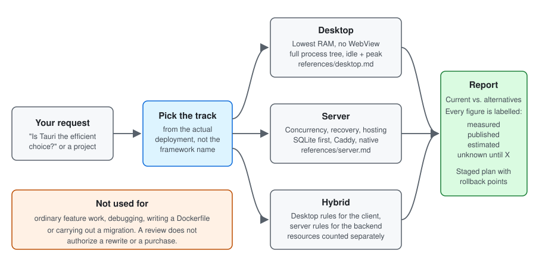
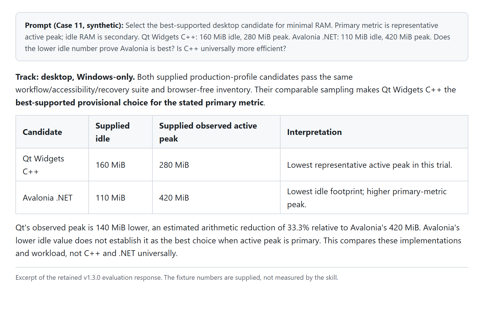

# Software Architecture Efficiency

A reusable agent skill for Codex, Claude Code and OpenCode for comparing resource-heavy architectures with practical, efficient alternatives.

## Try it

[Install the skill](#install), then paste one of these into your agent.

Codex:

> Use $architecture-efficiency to review this project. Compare the existing stack, tuning it, replacing expensive components and a simpler native stack. Include performance evidence, RAM, hosting costs, feature tradeoffs and a staged migration plan.

Claude Code:

> /architecture-efficiency Review this project. Compare the existing stack, tuning it, replacing expensive components and a simpler native stack. Include performance evidence, RAM, hosting costs, feature tradeoffs and a staged migration plan.

OpenCode:

> Use the architecture-efficiency skill to review this project. Compare the existing stack, tuning it, replacing expensive components and a simpler native stack. Include performance evidence, RAM, hosting costs, feature tradeoffs and a staged migration plan.

A plain question works too:

> Our Electron invoice app uses 620 MiB when idle. Is moving to Tauri the efficient choice?

The skill can also produce illustrative comparisons when no application is supplied. An architecture review does not authorize a rewrite, production changes or hosting purchases.

## Example output

The question is Case 11 in [evaluations/cases.md](evaluations/cases.md), a synthetic case: two desktop prototypes pass the same workflow and accessibility suite. Qt Widgets C++ idles at 160 MiB and peaks at 280 MiB; Avalonia .NET idles at 110 MiB and peaks at 420 MiB. The owner asks whether the lower idle number proves Avalonia is the best low-RAM choice, and whether C++ can be declared universally more efficient.

This is an excerpt from the retained [v1.3.0 evaluation response](evaluations/responses-v1.3.0.md), shown as it renders:

The same text:

> **Track: desktop, Windows-only.** Both supplied production-profile candidates pass the same workflow/accessibility/recovery suite and browser-free inventory. Their comparable sampling makes Qt Widgets C++ the **best-supported provisional choice for the stated primary metric**.
>
> | Candidate | Supplied idle | Supplied observed active peak | Interpretation |
> | --- | --- | --- | --- |
> | Qt Widgets C++ | 160 MiB | 280 MiB | Lowest representative active peak in this trial. |
> | Avalonia .NET | 110 MiB | 420 MiB | Lowest idle footprint; higher primary-metric peak. |
>
> Qt's observed peak is 140 MiB lower, an estimated arithmetic reduction of 33.3% relative to Avalonia's 420 MiB. Avalonia's lower idle value does not establish it as the best choice when active peak is primary. This compares these implementations and workload, not C++ and .NET universally.

The fixture numbers are supplied, not measured by the skill.

Read [the rationale](docs/rationale.md) for why the skill prioritizes minimal desktop RAM without WebViews, simpler server architectures, SQLite, Caddy and evidence-backed comparisons, including the tradeoffs and limits behind those choices.

Version: **1.4.0**. The skill version is recorded in `SKILL.md` under `metadata.version`; GitHub releases use matching tags such as `v1.4.0`.

The shared skill selects a **desktop**, **server** or **hybrid** review track from the actual application. Desktop guidance covers installed UIs, local data and distribution. Server guidance covers hosted services and browser applications, concurrency, recovery and hosting. Hybrid reviews apply each track to its own components while sharing evidence and reporting rules.

For desktop clients, the primary objective is **minimal RAM use with no embedded browser or WebView UI**. Electron and Tauri can be analyzed as existing baselines, but are not eligible final desktop targets. Compare non-WebView toolkits using full-application idle/active memory and required behavior; no framework is assumed to be the smallest. This restriction applies to the desktop part of hybrid systems, not browser-delivered server applications.

## Priorities

- Native host services instead of Docker where suitable.
- Compiled backends such as Go, Rust and compatible .NET Native AOT applications.
- Lean frontends: static output, server-rendered HTML and focused browser interaction.
- SQLite first, with an explicit migration path to PostgreSQL.
- Caddy for server reverse proxy and TLS where applicable.
- Lower CPU and RAM use, faster execution and realistic hosting costs.

Recommendations must preserve required behavior and distinguish measurements, estimates, published specifications and unknowns. Language or deployment preferences alone do not establish a performance improvement.

## Install

Copy the entire `skills/architecture-efficiency` directory into the skills directory of your tool. On Windows, `~` is `%USERPROFILE%`.

| Tool | All projects | One project | Start it by name |
| --- | --- | --- | --- |
| Codex | `~/.agents/skills/` | `.agents/skills/` | `$architecture-efficiency`, or pick it from `/skills` |
| Claude Code | `~/.claude/skills/` | `.claude/skills/` | `/architecture-efficiency` |
| OpenCode | `~/.config/opencode/skills/`, or either user directory above | `.opencode/skills/`, or either project directory above | Ask for the skill by name |

Sources: [Codex](https://learn.chatgpt.com/docs/build-skills), [Claude Code](https://code.claude.com/docs/en/skills), [OpenCode](https://opencode.ai/docs/skills).

Keep `SKILL.md`, `agents/` and `references/` together. `agents/openai.yaml` holds optional OpenAI interface metadata. If updating an existing installation, inspect and preserve local changes before replacing it. Start a new chat if the skill is not yet listed.

## Contents

- [Rationale and design decisions](docs/rationale.md)
- [Skill instructions](skills/architecture-efficiency/SKILL.md)
- [Desktop application track](skills/architecture-efficiency/references/desktop.md)
- [Server application track](skills/architecture-efficiency/references/server.md)
- [Alternative solutions](skills/architecture-efficiency/references/alternatives.md)
- [Requirements and decision guide](skills/architecture-efficiency/references/decision-guide.md)
- [Measurement definitions and comparison report](skills/architecture-efficiency/references/report.md)
- [Hosting options and price research](skills/architecture-efficiency/references/hosting.md)

Hosting prices are dated research snapshots and must be refreshed before current recommendations or purchases. They are not checkout quotes.

## Sources

The references link to official product documentation. The decision guide includes a selective synthesis of [Project-Foundations](https://github.com/erophames/Project-Foundations) at a pinned commit, with file-level attribution. This skill does not require that plugin or its workflow.

## Evaluations

Version 1.4.0 changes how the skill is found and used, so it was checked on that: in a [recorded run](evaluations/v1.4.0.md) on Claude Code (Claude Opus 5.5) and OpenCode (DeepSeek V4.1 Flash) the skill loaded on all 15 runs that should trigger it and on none of the 12 that should not, and Claude Code passed Cases 08 and 10 ([responses](evaluations/responses-v1.4.0.md)). The record lists what was not valid or not run, including Codex.

Version 1.3.0 has a [focused independent evaluation on five cases](evaluations/v1.3.0.md) covering the desktop/hybrid constraint, memory-based selection and a browser-app control. All five met the updated rubric in that run; [actual responses](evaluations/responses-v1.3.0.md) are retained. This does not claim eleven new passes or real application RAM benchmarks.

Historical evaluation outcomes apply to their version's rules; the corresponding release tag preserves the original cases and rubric. The 1.3.0 desktop policy supersedes earlier acceptance of WebView-based desktop targets.

Version 1.2.0 adds desktop/server/hybrid routing and a [recorded independent evaluation on ten cases](evaluations/v1.2.0.md), including three new desktop/hybrid cases. All ten met the rubric in that run. The [actual responses](evaluations/responses-v1.2.0.md), shared [case inputs](evaluations/cases.md) and [reviewer rubric](evaluations/rubric.md) are retained.

Version 1.1.0 includes a [recorded independent evaluation](evaluations/v1.1.0.md) on seven synthetic architecture cases, with [case inputs](evaluations/cases.md), a [reviewer rubric](evaluations/rubric.md) and [actual responses](evaluations/responses-v1.1.0.md). All seven met the rubric in that run. This checks analyst behavior on those scenarios; it is not an application benchmark or proof of general reliability.
